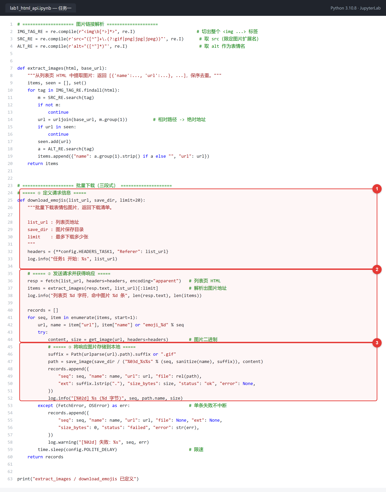
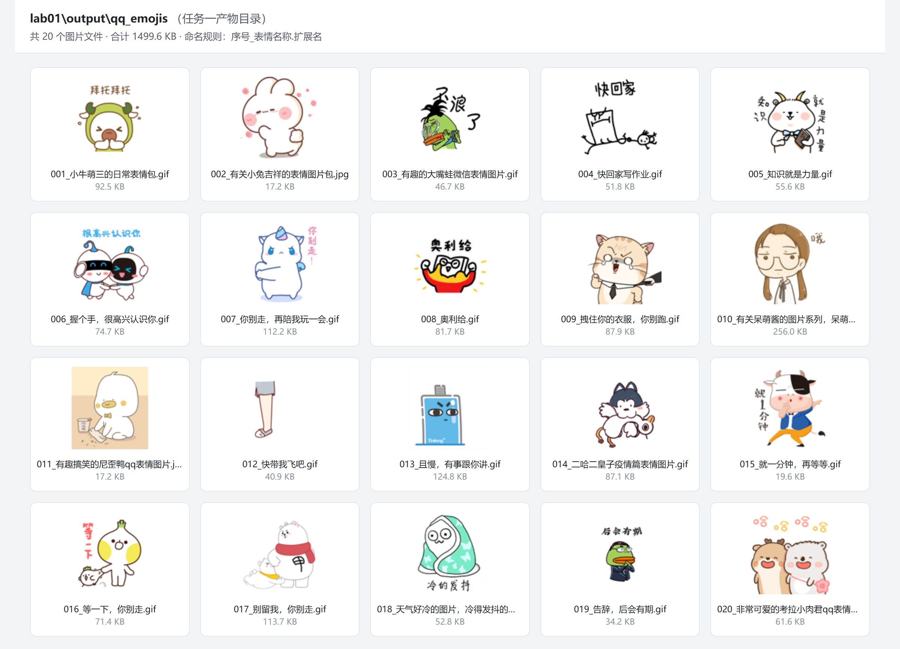
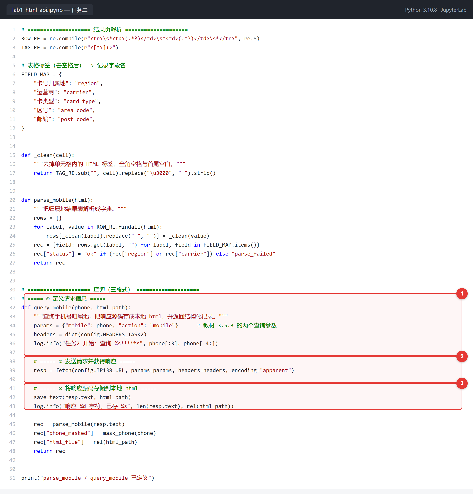
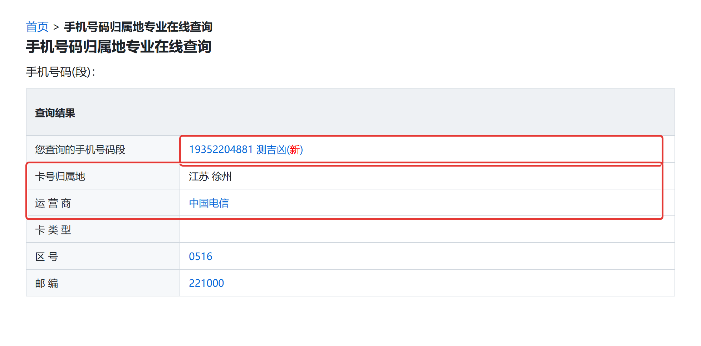

# 实验一 静态网页爬取

- 姓名：洪英杰
- 学号：112404150212
- 班级：软件工程1242班
- GitHub 用户名：shihen123
- 仓库地址：https://github.com/shihen123/bigdata-collection-labs-112404150212

---

## 一、实验目的与要求

### 1. 目的

（1）理解网络爬虫相关概念及执行流程；

（2）熟练使用 requests 库中的常用方法。

### 2. 要求

（1）实现 QQ 表情包图片下载功能（参考教材第 3 章 3.4 案例 1），编写为代码重构可复用版；

（2）实现手机归属地查询功能（参考教材第 3 章 3.5 案例 2），并将获取的响应源代码存储到本地 html，编写为代码重构可复用版，查询自己的手机号。

---

## 二、实验平台与环境

| 项 | 内容 |
| --- | --- |
| 1. 开发语言 | Python 3.10.8 |
| 2. 调用的包 | requests 2.34.2（发送 HTTP 请求）、re（正则解析）、urllib.parse（urljoin / urlparse 拼接与拆分 URL）、pathlib（路径处理）、json（结构化落盘）、logging（运行日志）、time（限速与重试间隔）；运行载体 jupyterlab 4.6.5 + ipykernel 7.3.0 |
| 3. 调试和运行环境 | Windows 11；PyCharm（解释器指向项目虚拟环境 `.venv`，Python 3.10.8）；JupyterLab 内核 `Python (lab01)`；Microsoft Edge / Google Chrome 用于打开本地 html |

两个任务的入口地址：

| 任务 | 地址 |
| --- | --- |
| 任务一 列表页 | `http://www.bspider.top/yh31/` |
| 任务二 查询页 | `https://www.ip138.com/mobile.asp`（参数 `mobile`、`action=mobile`） |

> 说明：课程镜像站 `http://www.bspider.top/ip138/` 只镜像了查询**表单页**，带参数请求它返回的仍是表单（实测 3,203 字节，无结果表格），因此任务二按教材 3.5.2 / 3.5.3 给出的地址 `https://www.ip138.com/mobile.asp` 发起查询。

---

## 三、实验内容与完成情况

### 1. 任务一：QQ 表情包图片下载（代码）

代码见 `lab01/lab1_html_api.ipynb` 第 4 个 cell，完整实现如下（红框 1 = 定义请求信息，2 = 发送请求并获得响应，3 = 将响应图片存储到本地）：



三个标注点的作用：

1. **定义请求信息**：设置 `headers`（`User-Agent` 伪装浏览器、`Referer` 指向列表页），并把列表页地址、保存目录、下载数量作为函数参数传入，保证同一份代码可以换页、换目录、换数量复用；
2. **发送请求并获得响应**：`fetch()` 内部完成超时控制、失败重试与 `raise_for_status()` 状态码校验，返回列表页 HTML；再用正则 `extract_images()` 抽出每张图片的地址与名称；
3. **将响应图片存储到本地**：用 `get_image()` 取 `r.content`（二进制），按 `序号_表情名称.扩展名` 命名，写入 `output/qq_emojis/`。

### 2. 任务一：本地表情包（运行结果）

`lab01/output/qq_emojis/` 下共下载 **20 个**图片文件，合计 **1499.6 KB**，全部下载成功（`devices.json` 中 `count = 20`、`success = 20`）：



下载清单同时以结构化形式保存在 `lab01/data/devices.json`，每条记录包含序号、表情名称、原始 URL、本地相对路径、扩展名、字节数与成功状态。

### 3. 任务二：手机归属地查询（代码）

代码见 `lab01/lab1_html_api.ipynb` 第 8 个 cell（红框 1 = 定义请求信息，2 = 发送请求并获得响应，3 = 将响应存储到本地 html）：



三个标注点的作用：

1. **定义请求信息**：构造查询参数字典 `params = {"mobile": 手机号, "action": "mobile"}`（与教材 3.5.3 的两个参数一致），并设置请求头；
2. **发送请求并获得响应**：`fetch()` 以 GET 方式提交参数，`r.encoding = r.apparent_encoding` 修正编码，返回响应文本；
3. **将响应存储到本地 html**：`save_text()` 把响应**源代码**完整写入 `output/mobile_query.html`，随后再用表格行解析函数 `parse_mobile()` 提取归属地字段。

### 4. 任务二：本地 html 打开效果

用浏览器打开 `lab01/output/mobile_query.html`，查询本人手机号（193\*\*\*\*4881），结果如下（红框为本人手机号与归属地部分）：



解析结果（同时写入 `lab01/data/companies.json`）：

| 字段 | 值 |
| --- | --- |
| 手机号码 | 193\*\*\*\*4881 |
| 归属地 | 江苏 徐州 |
| 运营商 | 中国电信 |
| 卡类型 | （该号码无此项，返回空） |
| 区号 | 0516 |
| 邮编 | 221000 |
| 解析状态 | ok |

---

## 四、遇到的问题和解决方法

**问题 1：教材重构版的文件名取法导致图片互相覆盖。**
教材 3.4.3 重构版写作 `file_name = url.split("/")[-1][0]`，`[-1]` 取到文件名后又加了 `[0]`，实际只保留文件名第一个字符。两张图会分别存成 `2` 这样没有扩展名的同名文件，后一张覆盖前一张，最终目录里只剩 1 个文件。
解决：改用 `Path(urlparse(url).path).suffix` 取扩展名，表情名称从 `` 的 `alt` 属性读取，文件名格式改为 `001_小牛萌三的日常表情包.gif`。

**问题 2：列表页的图片地址是相对路径，直接请求会失败。**
教材示例给的是完整地址 `http://www.bspider.top/static/yh31/images/xxx.gif`，而实际列表页里 `` 是相对路径，直接拿去请求拼不出合法 URL。
解决：解析后用 `urljoin(base_url, src)` 补全为绝对地址；同时把扩展名匹配从只认 `.gif` 扩展到 `gif|png|jpg|jpeg`，因为实测 50 条图片链接中有 4 条不是 gif。

**问题 3：镜像站的 ip138 页面查不到结果。**
按教材 3.5.1 的字面描述向 `http://www.bspider.top/ip138` 请求，返回页面只有 3,203 字节，是查询表单的静态副本，没有结果表格；查看表单源码发现 `action="https://www.ip138.com/mobile.asp"`，说明镜像站并未代理查询动作。
解决：改为直接请求 `https://www.ip138.com/mobile.asp`，参数为 `mobile` 与 `action=mobile`，实测正常返回包含"查询结果"表格的页面。

**问题 4：结果表标签中含全角空格，按关键词匹配取不到值。**
结果表的行是 `<tr><td>运 营 商</td><td>...</td></tr>`，标签本身带全角空格（"运 营 商""卡 类 型""区 号""邮 编"），直接用 `rows["运营商"]` 取值为空。
解决：解析时先剥掉 HTML 标签，再把全角空格 `\u3000` 转成半角并去掉所有空格，统一成"运营商"后再查映射表。

**问题 5：部分号码的"卡类型"为空，被误判为解析失败。**
实测本人号码的"卡类型"单元格为空字符串。若把"所有字段非空"作为成功条件，会误报失败。
解决：判定条件改为"归属地或运营商至少有一个非空"，卡类型允许为空，并在 `companies.json` 中如实记录空字符串。

**问题 6：异常被 `print` 吞掉，失败时无痕迹。**
教材写法 `except Exception as err: print(err)` 会把状态码异常、连接异常一并吞掉，且 `get_image` 失败时隐式返回 `None`，主函数继续执行 `f.write(None)` 才报 `TypeError`，排查困难。
解决：请求层统一封装为 `FetchError`，按 `Timeout` / `ConnectionError` / `HTTPError` 分级捕获并重试 3 次（间隔 1.5s 递增）；业务层对单张图片失败只记 `status="failed"` 与 `error` 原因，不中断整批下载，同时写 `logs/lab01.log`。

**问题 7：镜像站响应慢，单张图片耗时 30~60 秒。**
首次运行时按教材的 `timeout=3` 会频繁超时。
解决：超时改为 `(5, 15)`（连接 5 秒、读取 15 秒），并配合 3 次重试；20 张图片全部下载成功。

**问题 8：JSON 中路径分隔符为反斜杠，跨平台不可读。**
Windows 下 `str(Path)` 输出 `output\qq_emojis\001_xxx.gif`，写进 JSON 后转义成 `\\`，在 GitHub 网页上显示为双反斜杠。
解决：写 JSON 前统一用 `Path.as_posix()` 转成正斜杠，改为 `output/qq_emojis/001_xxx.gif`。

---

## 五、未解决的问题

无影响实验完成的问题。以下两点属可优化项，不影响本次实验结论：

1. 课程镜像站为教学用服务器，响应速度不稳定（单张图片 2~60 秒），本次通过加大超时与重试保证全部成功，但未做并发下载优化（本实验要求单线程顺序抓取即可）；
2. 归属地页面若日后改版，字段映射表 `FIELD_MAP` 需同步调整；目前已把映射集中在一处，改版时只需改这张表，不必改动解析逻辑。

---

## 六、本次实验用到的重要知识点或代码

**1. 本次实验中，使用 requests 库发送网络请求的代码是什么？**

```python
resp = requests.get(url, params=params, headers=headers, timeout=(5, 15))
resp.raise_for_status()          # 4xx / 5xx 主动抛异常
resp.encoding = resp.apparent_encoding   # 修正编码
```

任务一取图片二进制用 `resp.content`，任务二取网页文本用 `resp.text`。

**2. 如何判断所要爬取的网站，是 get 请求还是 post 请求？**

看浏览器开发者工具 Network 面板中该请求的 Method，或看参数是否出现在地址栏。教材 3.5.2 的判断依据就是"点击查询后网址跳转到 `...mobile.asp?mobile=...&action=mobile`，参数暴露在 URL 上"。本实验两个案例的表单都是 `<form method="get">`，参数拼在 URL 上，因此都是 GET 请求。

**3. 在发送请求的过程中，除了 URL，要求 1 中的请求信息还用到什么参数？要求 2 中的请求信息还用到什么参数？**

- 要求 1（下载图片）：用到 `headers`（`User-Agent` 伪装浏览器、`Referer` 指向列表页）与 `timeout`。
- 要求 2（查询归属地）：除 `headers`、`timeout` 外，还要传两个查询参数 `mobile` 与 `action=mobile`。教材用 `urllib.parse.urlencode(param)` 把它们拼成 `mobile=...&action=mobile` 接在 URL 后面，本项目改为交给 requests 的 `params` 参数，效果等价且自动处理编码。

**4. 在爬虫时，经常遇到中文乱码等编码问题，用什么代码可以解决？**

```python
resp.encoding = resp.apparent_encoding   # 依据响应字节自动推断编码，教材 3.5.3 的写法
# 已知编码时也可显式指定，例如：resp.encoding = "gbk"
```

本次实测 ip138 返回 `charset=UTF-8`，教材年代的页面为 `gb2312`，用 `apparent_encoding` 两种都能正确处理。

**5. 在获得响应 r 后，r.content 和 r.text 有什么区别？**

- `r.content` 是**未解码的原始字节**（`bytes`），适合图片、文件等二进制数据，本实验下载表情包用的就是它；
- `r.text` 是按 `r.encoding` **解码后的字符串**（`str`），适合 HTML 等文本，本实验保存归属地页面源码用的就是它。

**6. 为了爬虫程序的健壮性，通常采用 try...except... 机制，请按照自己的理解简述这种机制。**

把可能出错的请求代码放进 `try`，按异常类型分别 `except` 捕获并处理（重试、记录或跳过），使个别请求失败不影响整体流程。

**7. 在处理异常的过程中，r.raise_for_status() 有什么作用？**

检查响应状态码，若为 4xx 或 5xx 则抛出 `HTTPError`，从而在解析之前就中断并进入异常处理，避免把错误页面当成正常数据继续解析。教材 3.4.3 也指出"由于没判断响应码状态，可能出现数据返回但状态码不为 200，导致后续程序代码异常"，这正是该方法要解决的问题。

---

## 附：产物清单

| 文件 | 说明 |
| --- | --- |
| `lab01/lab1_html_api.ipynb` | 实验主程序，`Restart Kernel → Run All` 可完整复现 |
| `lab01/data/devices.json` | 任务一 下载清单（20 条记录） |
| `lab01/data/companies.json` | 任务二 归属地查询记录 |
| `lab01/output/qq_emojis/` | 任务一 下载的 20 个表情包图片 |
| `lab01/output/mobile_query.html` | 任务二 响应源代码 |
| `lab01/images/01~04*.png` | 本报告 4 张截图 |
